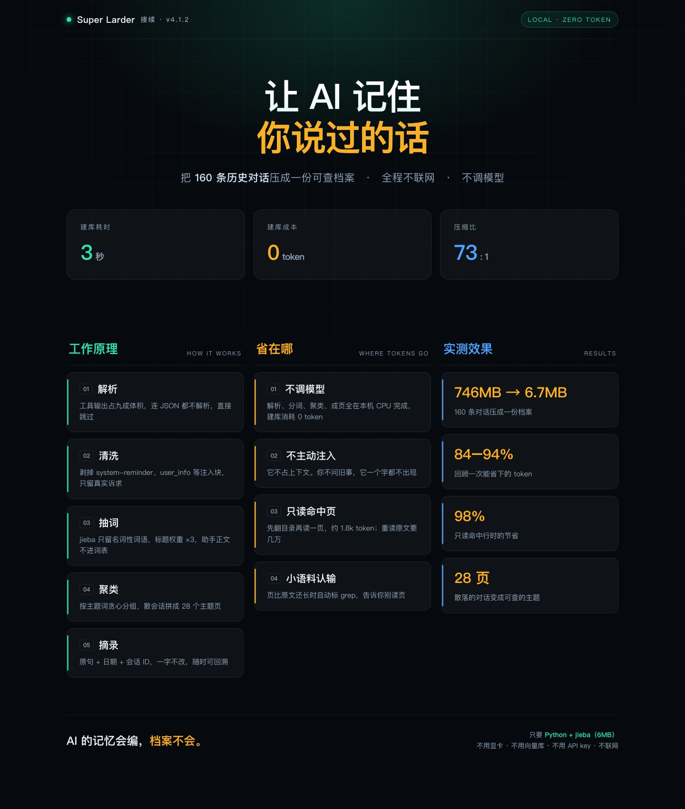

# Super Larder

**The point is saving tokens. An archive, not a memory.**

A *larder* is where you keep what you've already paid for, so winter costs nothing.

[中文](README.zh-CN.md) · English

Turns your past conversations into a local, searchable archive so the assistant stops re-reading raw transcripts — **without calling a single LLM, without a GPU, without uploading a byte. Zero tokens to build; 84–94% fewer tokens on every revisit.**

### Read once. Answer forever.




---

## The problem

Every new chat starts amnesiac.

Yesterday's decisions get re-explained today. Last week's pitfalls get re-hit this week. After three months you've told the same assistant the same thing three times, and it remembers none of it.

The expensive part isn't your time — it's the tokens. Every time it "re-understands" you, it burns your quota.

The real fix isn't a smarter model. It's giving the model **something it can look up**.

---

## What it does

```
your client writes transcripts ──> build.py (pure CPU) ──> archive ──> assistant reads
                                          ↑
                              runs automatically before each lookup
```

| Layer | Job | Cost |
|---|---|---|
| `build.py` | clean, extract, cluster, render, index | **0 tokens**, 1–3 s |
| `wiki/` + `raw/` | topic pages, session snapshots, keyword index | plain Markdown + JSON |
| Review | read a ten-line report, spot-check two pages | a few hundred tokens |

**The archive builds itself.** There is no separate curation step — no import, no tagging, no editor. Point it at the transcripts your client already writes and it grows on its own.

---

## Measured

**What you actually save is tokens.** Building the archive costs zero; every revisit costs a fraction of re-reading the raw sessions.

101 sessions / 15,459 messages / 627 MB of raw transcripts, on an ordinary desktop:

| Metric | Value |
|---|---|
| Cold build | **2.9 s** |
| Incremental rebuild | **0.8 s** |
| Archive size | 22 pages / 39,946 tokens |
| Compression | **73 : 1** (2.93M → 40K tokens) |
| Tokens spent building | **0** |
| Retrieval lookup | **17 ms** |

Cost of reading (average page: 1,815 tokens):

| Task | Without | With | Saved |
|---|---|---|---|
| Revisit one topic (2 median sessions) | 11,390 | 1,815 | **84%** |
| Revisit one large session | 29,610 | 1,815 | **94%** |
| Read matched lines only | 11,390 | 241 | **98%** |

> "98.6%" would be the figure if you read the entire corpus. Nobody does that. Quote 84–94%.

---

## How it works

1. **Scan** the JSONL transcripts your client writes
2. **Clean** — strip system reminders, tool notifications and their boilerplate residue
3. **Extract** — jieba POS tagging, nouns only; titles weigh 3×, user prompts 1×, assistant bodies are excluded (all tool noise lives there)
4. **Redact** — passwords, keys and phone numbers become `***`
5. **Cluster** — group sessions by shared topic terms; leftovers fall into monthly digests
6. **Render** — conclusions are quoted **verbatim with a date and session id**, never paraphrased
7. **Write** — pages, index, keyword map, log — then self-check

### Three rules

**No model dependency.** Python 3.9+ and jieba. No GPU, no API key, no local LLM.
Most people don't have a local model — wiring the feature to one means only a handful can use it.

**Extractive, with provenance.** Every conclusion carries a date and session id. Check it against the original. A model's memory hallucinates; an archive doesn't.

**Redaction beats fidelity.** Credentials are masked before anything lands on disk, because an archive gets committed, synced and backed up. `lint` scans every snapshot and exits non-zero on a hit.

---

## Install

1. Drop the folder into `~/.workbuddy/skills/super-larder/`
2. Run the installer:
   - **macOS** — double-click `setup.command` (if macOS refuses, `chmod +x setup.command` first)
   - **Windows** — double-click `setup.cmd`
   - **Linux / any** — `python3 setup.py`
3. Restart your client

The installer checks Python, installs jieba if missing, writes a config, builds the first archive and prints a review report.

**Requires**: Python 3.9+, ~10 MB disk. **Does not require**: GPU, local model, API key, network (beyond the first `pip install jieba`).

All three platforms run the same code — there is no platform-specific branch. On macOS with a Homebrew Python, pip may be blocked by PEP 668; the installer retries with `--user` and tells you what to do if that fails too.

---

## Usage

No maintenance required. The assistant rebuilds the archive before a lookup (about 1.4 s, silent).

You can also just ask:
- "Did I ever work on X?"
- "What did we settle on last time?"
- "Use the same rules as before"

Or read the files: `index.md` in the archive root is the table of contents.

`config.json`:

```json
{
  "kb_root": "~/super-larder-kb",
  "projects_root": null,
  "domain_words": ["your", "domain", "terms"]
}
```

`domain_words` tells the tokenizer what counts as a word in your field. Optional, but topic names get noticeably better.

---

## When it pays off

This does **not** save tokens unconditionally. Reading a page costs 1,100–1,800 tokens; it only pays if it replaces more reading than that.

So every page carries its own verdict:

```yaml
payload_chars: 3131     # size of this page
covered_chars: 94519    # size of the raw sessions it covers
read_hint: page         # page | either | grep
```

| `read_hint` | What to do |
|---|---|
| `page` | Read it. Covers ≥1.5× its own size |
| `either` | Read the matched lines first |
| `grep` | **Don't read the page** — take the matched lines or the raw snapshot |

Measured distribution (101 sessions): 12 `page`, 8 `either`, 2 `grep`.
On a small corpus it inverts: 9 short sessions gave 3 pages, all `grep` — reading them was a net loss.

**The determining factor is how long your conversations are.** Three-turn exchanges don't pay for an archive.

---

## Limitations

- **It's an archive, not a memory.** The assistant has to look something up, and only knows what was said and recorded.
- **No reasoning uplift.** It supplies leads, not conclusions.
- **Keyword retrieval, not semantic.** Synonyms can be missed.
- **Topic names drift.** Every build re-clusters the whole corpus, so new sessions can merge or rename pages.
- **WorkBuddy transcript format only.** Adapt `parse_session()` for other clients.
- **Savings are bounded.** ~8% of monthly spend in steady state, 84–94% per revisit. It won't halve your bill.

---

## Commands

```bash
python scripts/build.py build           # incremental refresh
python scripts/build.py build --force   # full rebuild (after changing extraction rules)
python scripts/build.py build --quiet   # silent, used by the skill itself
python scripts/build.py report          # review report
python scripts/build.py lint            # schema + credential scan
python scripts/build.py stats           # overview

python scripts/recall.py search "keyword" --since 90d --limit 5
python scripts/recall.py show <session-id>
```

---

## License

MIT
